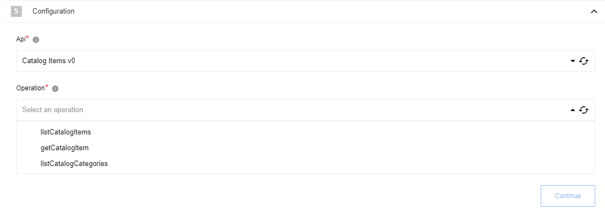
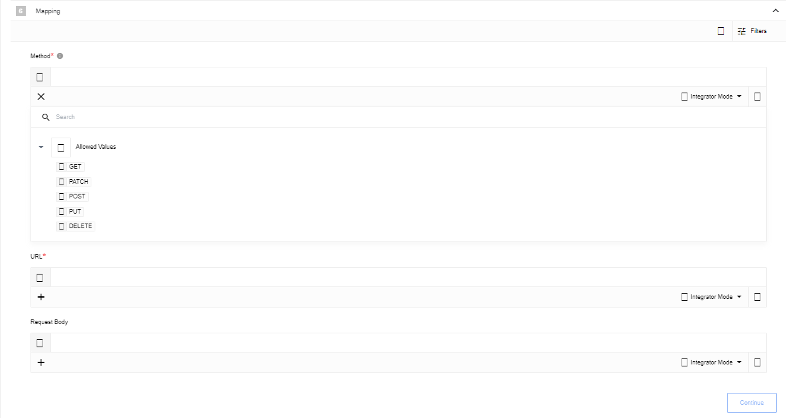

## AVA 1.0.0 release status — 2026-10-30

**PUBLISHED scoped; WAITING HOST #72/#75 integration; #80 grantless verifier, polling and binary parity; #81 deprecated operations and restricted-data-token orchestration.** [Published source](https://github.com/thatapp/connector-amazon-selling-partner-api/tree/2d2cf6bed99228500ae1a49e97db810dc23b0bc3) · [Contract report](https://github.com/thatapp/connector-amazon-selling-partner-api/blob/2d2cf6bed99228500ae1a49e97db810dc23b0bc3/REPORT.md) · [Intake evidence](https://github.com/thatapp/connector-amazon-selling-partner-api/blob/2d2cf6bed99228500ae1a49e97db810dc23b0bc3/evidence/intake.json).

Execute Operation, Make Raw Request and Retail Procurement Orders polling are implemented with recorded REST requests and Login with Amazon (LWA). This documentation chat independently read the immutable report and accepted intake: 57 offline tests, 34 canonical isolated-worker outcomes, allowlist and secret scan passing (39 files), zero network attempts. The publisher also records 57 sealed-loader tests, 35 supplemental worker audits and 13 independent root worker probes with initially empty parent/transport redactors; this chat did not rerun those suites.

The pinned official catalogue contains 73 API/version models and 393 operation schemas. Eight restricted/deprecated operations are explicitly refused. The other 385 have generic modeled JSON request/metadata support; this is not evidence of 385 independently exercised vendor integrations. Nine explicitly matched grantless operations have exact native request and scoped-token tests. Raw requests retain seller/host-token behavior and do not infer grantless scope from a URL.

Current authentication uses unsigned LWA requests. The historical AWS access key, secret key, role/session and role-region fields remain optional and unused. Seller operations use a refresh token or supplied host access token. Grantless operations always obtain a fresh client_credentials token with the mapped scope and ignore an injected seller token; refresh_token is not sent alongside scope. No token cache, seller fallback after a failed grantless exchange or automatic credential-store update is implemented.

Endpoint/region pairs are validated. The sendTestNotification grantless operation alone accepts the three official sandbox endpoints; other modeled/raw/polling operations remain production-only. Credential verification remains a production seller marketplace-participation check with a permission-based vendor-order fallback. Grantless-only and sandbox credentials cannot pass that verifier; UI credential creation/bypass and actual application grants remain unverified. The report records the official short grantless table's v2 deleteSubscriptionById discrepancy; the implementation retains its pinned model and operation page's v1 route.

Polling supports Retail Procurement Orders with Created After only, one page of up to 100 per invocation, a fixed timestamp window and opaque nextToken saved after data. Changed configuration resets the cursor. It caps 1000 pages and 10000 unique row hashes per window. Query order-availability time and output purchase-order time may differ; equivalence, backdated results and live scheduler behavior are unverified. Additional polling objects and updated-only polling are not built.

Restricted-data-token orchestration, excluded Orders v0 operations, binary/feed document transfer, presigned URLs, decompression, external schema downloads, multipart/form workflows and asynchronous-job orchestration are not built. Execute performs one modeled JSON request. Vendor format/domain constraints, account permissions and changing API availability remain unverified. The tested host enforces 60-second steps and bounded HTTP; no unbounded retries or polling loop is provided. Clean-room records token exchange unsent and emits no fabricated success or snapshot.

The receipt pins host `4576be108e21b597d1fbffd4163fb05cd821c834` and harness `c749ffb4d1fc694a2487509fb7dd257625c42a09`. This chat independently verified the tag and absence of a main ref. The release uses feature branches. Reviewed host transport/redaction integration remains required; the tag does not establish deployment.

Installation, deployment, live vendor/account acceptance and UI behavior remain **UNVERIFIED**. Follow the single [#62 install table](https://gitlab.com/TECHeGO/thatapp-ai-powered/-/issues/62). Historical metadata and reference text below remain for context; the published scope and limitations above supersede conflicting runtime claims.

---

## Description

The Selling Partner API (SP-API) is a REST-based API that helps Amazon selling partners programmatically access their data on orders, shipments, payments, and much more.

## Credentials

To fill up all parameters, you need:

1. Create [IAM policies](https://developer-docs.amazon.com/sp-api/docs/creating-and-configuring-iam-policies-and-entities) to add new access key
2. [Register](https://developer-docs.amazon.com/sp-api/docs/registering-your-application) your Application
3. [Authorize Application](https://developer-docs.amazon.com/sp-api/docs/self-authorization)

From IAM:

From Application:

After Application authorization:

Component credentials configuration fields:

{% include img.html max-width="80%" url="img/credentials.png" title="Credentials" %}

* **The marketplace endpoint** (string, required) - Indicates what URL base needs to be used, one of the [following](https://developer-docs.amazon.com/sp-api/docs/sp-api-endpoints)
* **Client identifier** (string, required) - Application Client identifier
* **Client secret** (string, required) - Application Client secret
* **Refresh token** (string, required) - Token that you got after application authorization
* **App region** (string, required) - region [depends](https://developer-docs.amazon.com/sp-api/docs/sp-api-endpoints) on `The marketplace endpoint`
* **AWS access key** (string, required) - IAM user access key
* **AWS secret access key** (string, required) - IAM user secret access key
* **Role** (string, required) - IAM ARN
* **Role Session Name** (string, optional) - Session Name (may be leaved empty)
* **AWS role region** (string, required) - IAM user region

## Triggers

### Get New and Updated Objects Polling

Retrieve all the updated or created objects within a given start time.

#### Configuration Fields

* **Object Type** - (dropdown, required): Object-type to lookup on. E.g `Retail Procurement Orders v1 getPurchaseOrders`.
* **Timestamp field to poll on** - (dropdown, optional): Currently supported `Created After` option only.
* **Emit Behavior** - (dropdown, optional):  output method. Defaults to: `Emit individually`
* **Start Time** - (string, optional): The timestamp, in ISO8601 format, to start polling from (inclusive). Default value is the beginning of time (January 1, 1970 at 00:00.000).

#### Input Metadata

There is no Input Metadata in this trigger.

#### Output Metadata

Depend on fields `Object Type` and `Emit Behavior`. Generated dynamically - if `Emit Behavior` is set as `Emit individually` - each item from results will be emitted individually, if `Emit page` - all found objects will be emitted in one array `results`. A maximum of 100 elements will be returned per execution.

## Actions

### Execute operation

Execute operation based on prided information

#### Configuration Fields

* **Api** - (dropdown, required): Select an Api and version to use for this request
* **Operation** - (dropdown, required): Select an operation supported by this Api

#### Input Metadata

And dynamically generated fields according to chosen `Api` and `Operation`

#### Output Metadata

Result of execution provided by server

### Make Raw Request

Executes custom request.

#### Configuration Fields

* **Don't throw error on 404 Response** - (optional, boolean): Treat 404 HTTP responses not as error, defaults to `false`.

#### Input Metadata

* **Url** - (string, required): Path of the resource relative to the base URL.
* **Method** - (string, required): HTTP verb to use in the request, one of `GET`, `POST`, `PUT`, `PATCH`, `DELETE`.
* **Request Body** - (object, optional): Body of the request to send.

#### Output Metadata

* **Status Code** - (number, required): HTTP status code of the response.
* **HTTP headers** - (object, required): HTTP headers of the response.
* **Response Body** - (object, optional): HTTP response body.

## Limitation

All schemas for `Execute operation` action based on [this](https://github.com/amzn/selling-partner-api-models) Amazon repository models
