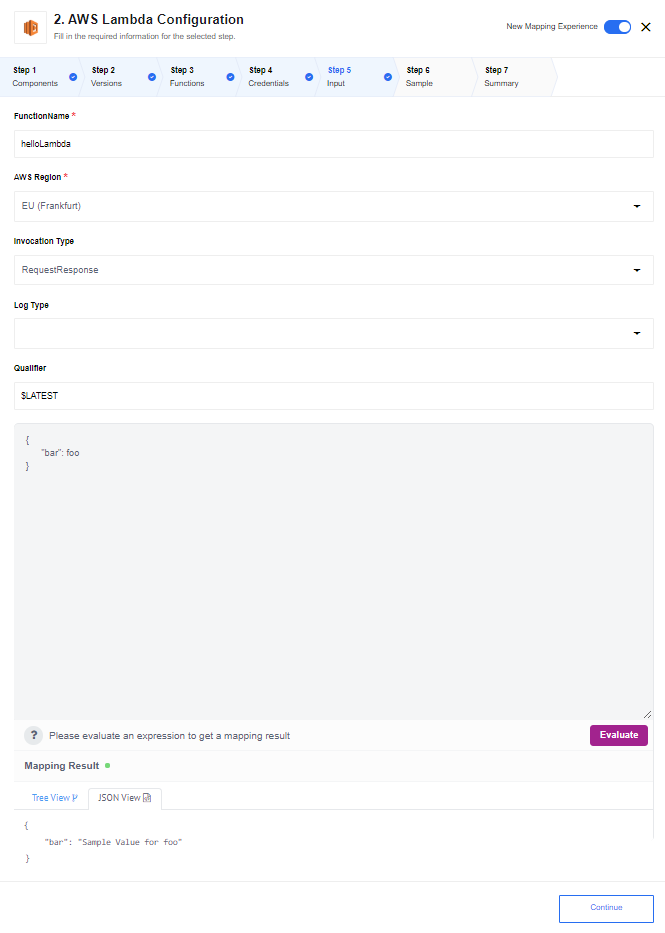

## AVA 1.0.0 release status — 2026-10-30

**PUBLISHED scoped; WAITING HOST #72 credential redaction and #75 text/XML transport; long synchronous execution remains a qualified #80 limitation.** [Published source](https://github.com/thatapp/connector-amazon-aws-lambda/tree/196a02f22b79e8e00e9b1e7497dc478664ecb848) · [Contract report](https://github.com/thatapp/connector-amazon-aws-lambda/blob/196a02f22b79e8e00e9b1e7497dc478664ecb848/REPORT.md) · [Intake evidence](https://github.com/thatapp/connector-amazon-aws-lambda/blob/196a02f22b79e8e00e9b1e7497dc478664ecb848/INTAKE.json).

The release passes all four intake gates on Node 20.20.2 and 24.13.0: 47 offline tests, actual sealed loader/context execution, require allowlist and secret scan. Eighteen canonical cases produce 27 isolated-worker runs; six additional worker checks cover verification, errors, redaction, retry behavior, Tail logs and JSONata timeout. Network attempts: zero. The links pin commit `196a02f22b79e8e00e9b1e7497dc478664ecb848`; installation and live account behavior remain **UNVERIFIED**.

The one action, **Invoke a lambda function**, retains FunctionName, AWS Region, Invocation Type, Log Type, Qualifier and JSONata Expression. It uses signed HTTP through the host instead of the old AWS SDK. The lowercase Qualifier field is now honored. RequestResponse is the default; Event returns an acceptance envelope, not an execution result. DryRun and triggers are not offered. Omitted JSONata forwards the incoming body.

Credentials retain AWS Access Key and AWS Access Secret. Verification uses a signed STS GetCallerIdentity read in `us-east-1`, replacing the source's unconditional success. This verifies identity, not permission to invoke a particular function. Only static credentials and standard commercial AWS endpoints are supported; no temporary-token renewal or other AWS partition is offered. The original ten region choices remain in the selector.

A JSON object result becomes the emitted body. Arrays, scalars, null, empty and non-JSON results use `{StatusCode, Payload}` so the body remains an object. HTTP 200 with a FunctionError is an error and emits no success. Tail can be requested with RequestResponse, but returned function logs are discarded, matching the recovered source; the old promise of platform log output below does not apply.

Requests and responses are bounded at 4 MiB for synchronous invocation; Event requests at 1 MiB. JSONata 2.2.2 has a 64 KiB expression limit, stack/sequence guards and a one-second evaluator deadline. That evaluator deadline does not cover every native regular expression; the isolated worker also has an outer deadline. No environment variables are required.

The candidate host's HTTP deadline is 15 seconds. Longer synchronous functions are unsupported; a timeout may happen after AWS accepts the invocation. The connector does not automatically retry, and manually retrying can duplicate effects. AWS may itself retry or redeliver asynchronous Events. This is not an exactly-once contract.

The tested host is MR129 at `2483881b48440a06b21288085ecf7d7e29c7634a`, with the MR157 intake harness at `8b953726f61a36e13963763273457c9bc2ad1421`. Host integration and installation remain in the single [#62 table](https://gitlab.com/TECHeGO/thatapp-ai-powered/-/issues/62). No attachment store is needed for this connector. Live AWS acceptance, IAM permissions, UI rendering and deployment remain **UNVERIFIED**.

The older reference and metadata version below describe the source component. The AVA scope and limits above supersede conflicting output, logging, verification and availability claims. Historical release entries remain preserved.

---

## Requirements

### Environment variables

None required.

### Credentials

The component requires the following credentials to authenticate with the AWS services:

*   `AWS Access Key` - this is your Access Key ID when you created the AWS account
*   `AWS Access Secret` - this is your Secret access key given to you during the key creation

These keys are displayed only once, just after the creation of the credentials in AWS.
To generate new ones follow the instructions given at [Getting Your Credentials](https://docs.aws.amazon.com/sdk-for-javascript/v2/developer-guide/getting-your-credentials.html) page.

### Technical Notes

The [technical notes](technical-notes) page gives some technical details about AWS-Lambda component like [changelog](/components/aws-lambda/technical-notes#changelog).

## Triggers

This component has no trigger functions. This means it will not be accessible to
select as a first component during the integration flow design.

## Actions

### Invoke a lambda function

This action will invoke a AWS Lambda function. It has following configuration parameters:



Please refer to the [AWS Lambda documentation](http://docs.aws.amazon.com/lambda/latest/dg/API_Invoke.html) for
more information about the parameters.

Incoming JSON can be adjusted using the *JSONata Expression* field. Please make
sure result of evaluation is a valid JSON.

Action supports returning JSON value as result.

If invocation was successful then action tries to parse resulting payload
as `JSON` and if parsing was successful then action emits a new message
with the resulting JSON as `body`.

If JSON parsing of the payload after successful invocation fails then action emits the
message with body equal to `AWS.Response`, like this:

```json
{
  "StatusCode": 200,
  "Payload": "result from the lambda invocation"
}
```

If `LogType` was set to `Tail` then the last 4 KB of the log will be returned
with the response and will be logged out to component log standard output (and
visible in the platform log)

## Known issues

*   Invocation Type ``DryRun`` is not supported - make no sense in the context
