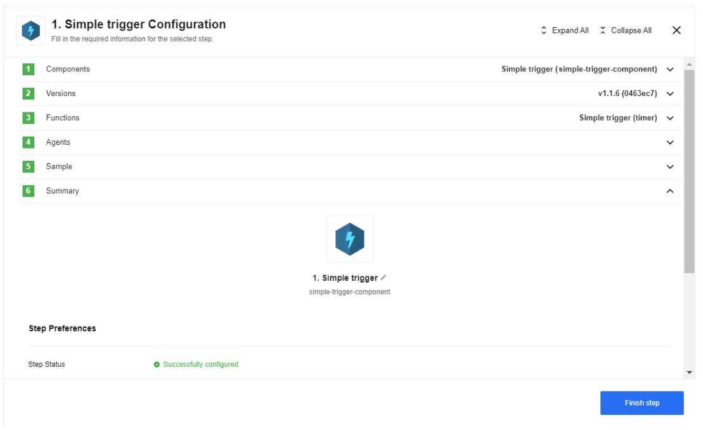
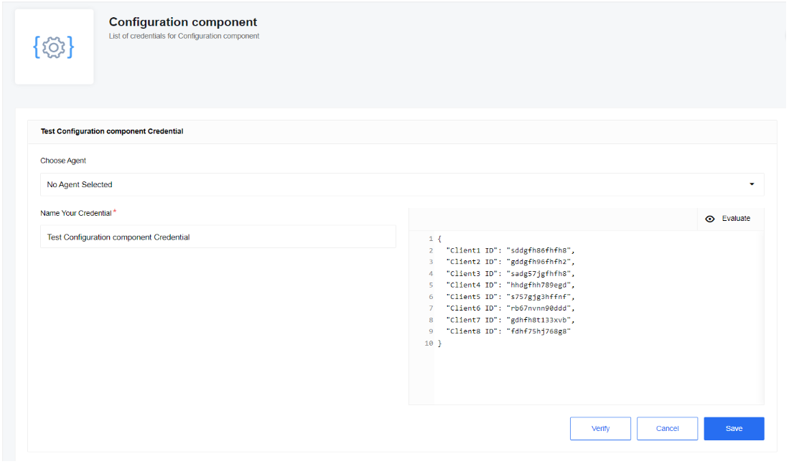
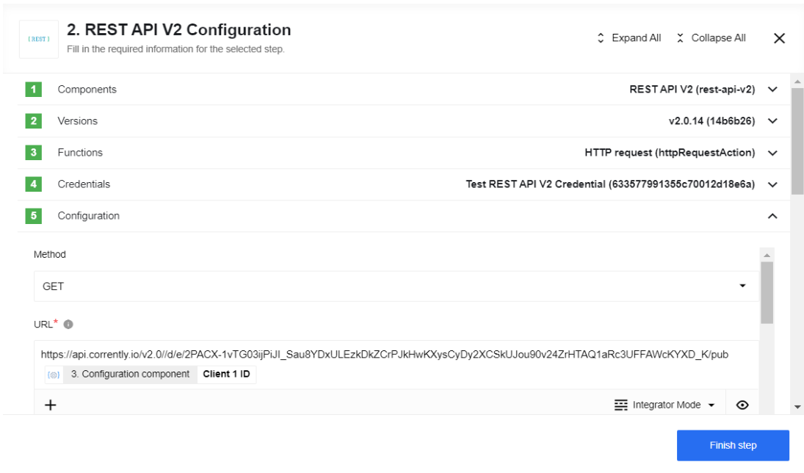
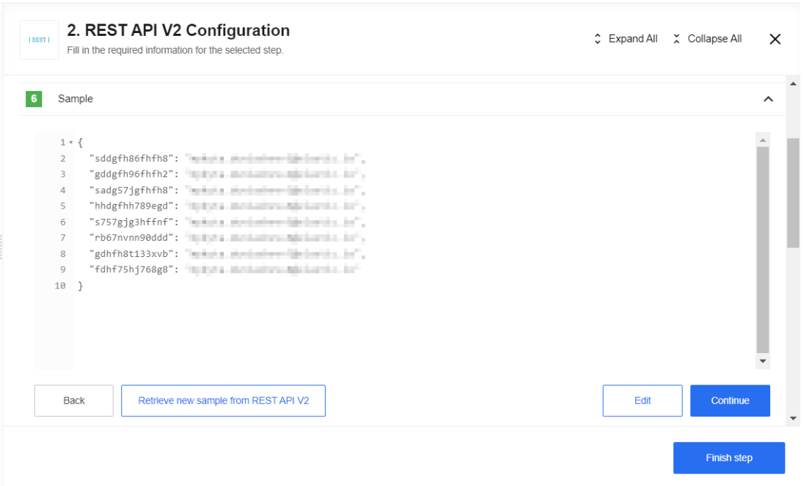
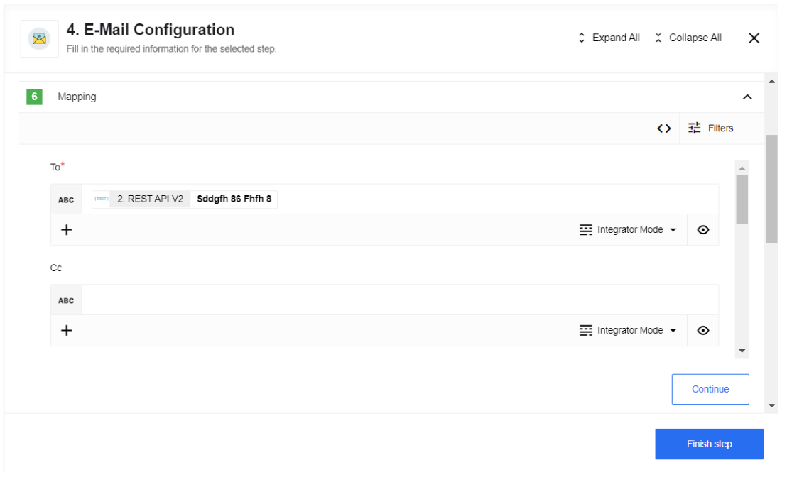
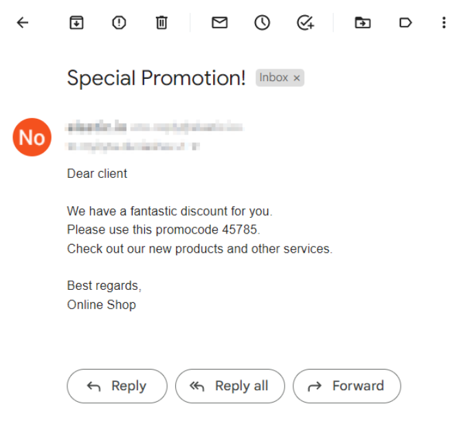

## AVA 1.0.0 release status — 2026-10-30

**Published conditionally: #57/#72 remain required; not installed or live verified.** [Exact source](https://github.com/thatapp/connector-configuration-component/tree/496585cba0e0ef032229890a5ed357fdd3c4f6e8) · [Full report](https://github.com/thatapp/connector-configuration-component/blob/496585cba0e0ef032229890a5ed357fdd3c4f6e8/REPORT.md) · [Packaged intake](https://github.com/thatapp/connector-configuration-component/blob/496585cba0e0ef032229890a5ed357fdd3c4f6e8/INTAKE.json).

The Emit data action parses saved configData as literal JSON and emits one object. The root must be a non-null object, including an empty object; nested arrays are supported. The supplied string is limited to5120 UTF-8 bytes including whitespace and depth30. Nonfinite parsed numbers, invalid Unicode and __proto__/constructor/prototype property names refuse. Duplicate keys keep their last value and numbers retain JavaScript precision. These explicit bounds supersede unrestricted-complexity prose below. Verification and execution share validation; emission is awaited without retry or snapshots.

Saved configuration takes precedence over node and message overrides, and an updated saved value is used by the next tested dispatch. configData is ordinary nonsecret configuration, not encrypted secret storage; downstream values remain intact while normal record masking applies. The actual catalog advertises component_verify available:true and on_save:true, and real verifier calls pass/refuse. #57 concerns authenticated browser/UI acceptance. The inherited JSONataView currently becomes a generic text field; JSONata expressions, Evaluate/editor behavior, realtime caching and transactional updates across flows are unverified. No triggers, network requests, dependencies or environment variables are introduced. The separate Simple/REST/Email example is not qualified by this release.

Final committed checks on both Node20.20.2/24.13.0 pass33 offline tests,36 canonical sealed-worker outcomes, the unchanged require allowlist,61-file secret scan and standalone hostcheck. The saved-configuration proof passes29 checks/23 actual workers/23 real store rounds. Independently authored tests were rerun with92 checks/82 instrumented workers/88 store rounds plus two separate sealed-loader controls per runtime; zero external network attempts. Synthetic in-memory persistence exercises actual flow-store/resolver/dispatcher/verifier code, not a deployed database. Packaged INTAKE.json explicitly identifies reviewed runtimeaf28789 before documentation/evidence packaging; external final publication receipts pin the released commit. Both original source failures and packaging corrections remain disclosed in REPORT. Original source, seven screenshots, three complete pages and historical release text are preserved.

Annotated tag7585442619ddbcf2b2b7435c2bbecbb199cbafb2 peels to the source above; main remainsc3db1f8eaf6c29e9476d3a7551d85990bc6016d2. Installation follows the single [#62 table](https://gitlab.com/TECHeGO/thatapp-ai-powered/-/issues/62). Historical release notes and example material below remain historical, with the release qualifications above controlling current availability.

---

## Online Shop example

In our example, we will be sending emails to our important customers. We will get access to the clients' IDs with the help of a Configuration component that will later pass this data on to get access to the clients' email addresses from the CRM system.

As the first step, we will use the Simple trigger component, since there is no trigger function in the Configuration component:

In the second step we will use the Configuration component with our credentials - it emits JSON which was put in the credential field. Credential field consist of IDs of the most important clients:

The third step uses the REST API v2 component which makes an API call to the CRM system that retrieves email addresses by client IDs:

Here you can see the client email addresses Sample data:

The final step is the E-Mail component which sends mail to our clients.

As a result, you can see an example of an email that our client will receive:

