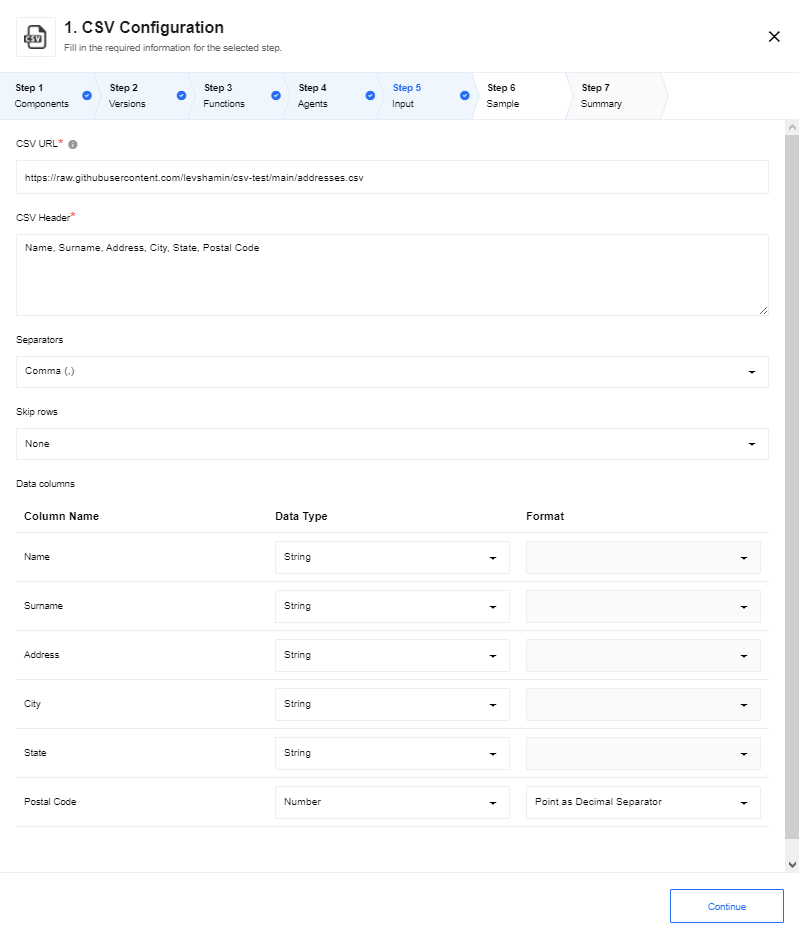
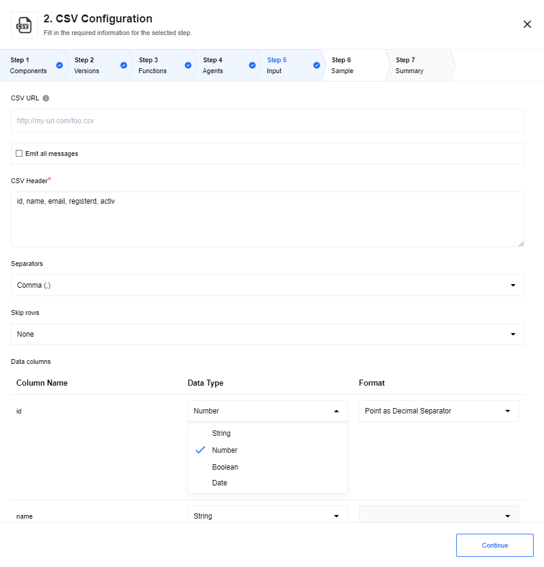
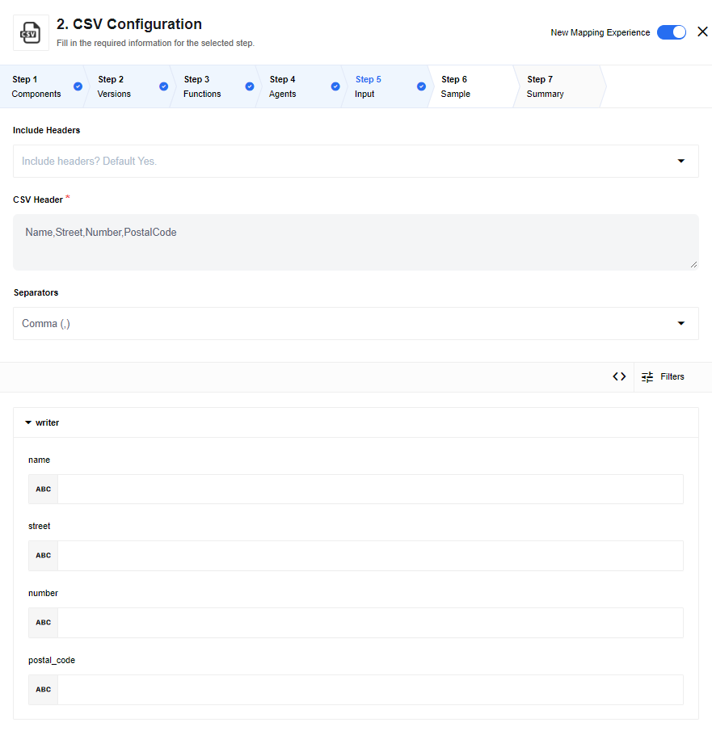
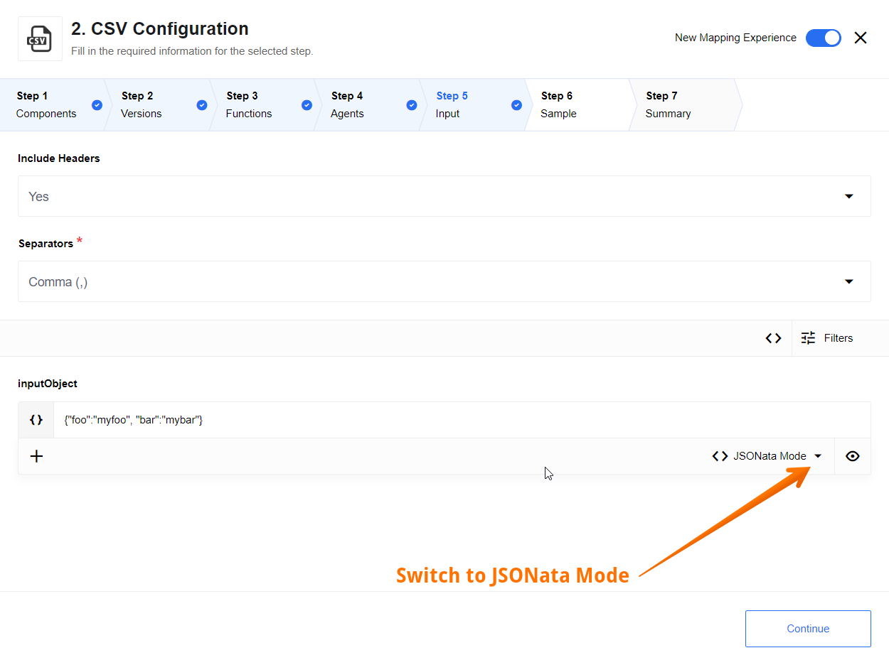
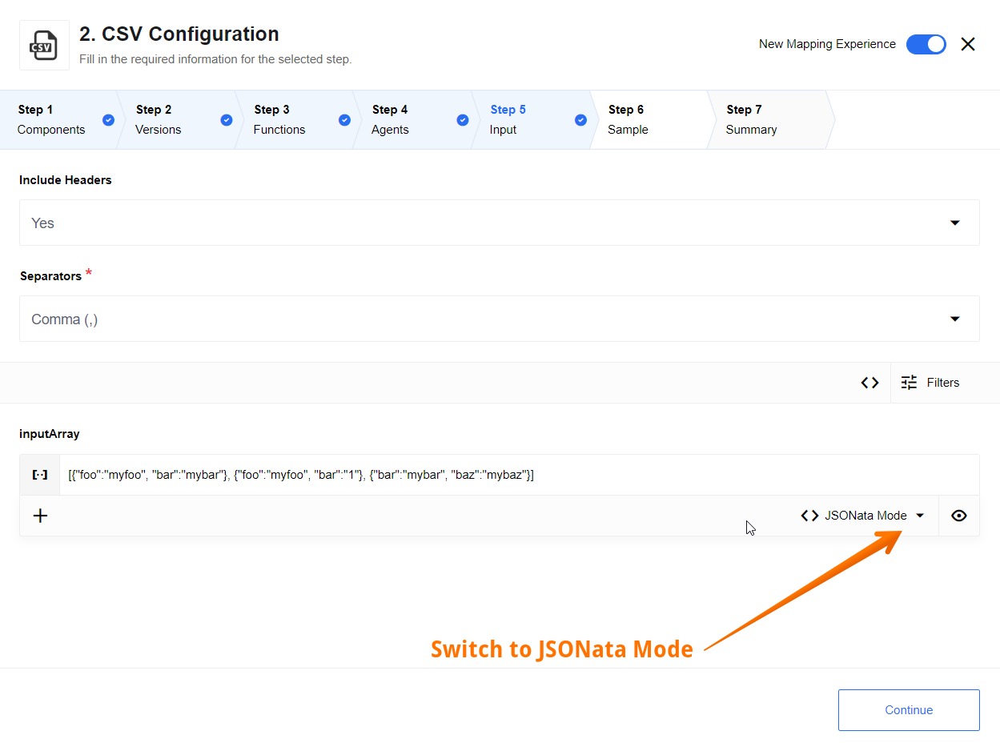

## AVA 1.0.1 release status — 2026-10-31

**Published conditionally; installation and final combined-host qualification remain open.** [Exact source](https://github.com/thatapp/connector-csv/tree/6f272f25722604283340fa1ac477baee59ded31c) · [Full report](https://github.com/thatapp/connector-csv/blob/6f272f25722604283340fa1ac477baee59ded31c/REPORT.md) · [Pinned qualification](https://github.com/thatapp/connector-csv/blob/6f272f25722604283340fa1ac477baee59ded31c/evidence/qualified-1.0.1/qualification.json) · [Draft PR1](https://github.com/thatapp/connector-csv/pull/1). Conditions remain #57/#58/#72/#75/#80/[#87](https://gitlab.com/TECHeGO/thatapp-ai-powered/-/issues/87), trusted production storage/clock and live/UI interoperability. Follow the sole [#62 install table](https://gitlab.com/TECHeGO/thatapp-ai-powered/-/issues/62). No READY, install or deployment is claimed.

All four declared entries have positive isolated-worker proof. Reads require complete anonymous HTTPS200 binary bytes or a caller-owned scoped attachment. They cover Fetch All/Individual/Batch, header/delimiter/comments/empty-line policy and bounded numeric/boolean conversion. Arrays map items/header with optional column order/separator/newline and the documented backtick formula prefix. Empty final single-column rows are explicitly quoted. attachmentUrl contains a scoped reference object; clean-room attachment writes remain unsent501. The polling trigger rereads its full URL and has no change watermark/deduplication.

Create CSV From Message Stream validates one mapped items object and boolean header, then stages a bounded row in the parent durable window. Pending acceptance emits no CSV or snapshot. New input extends the inactivity deadline; a gap strictly longer than ten seconds closes the window. A leased immutable flush renders stored rows and follows the ordinary downstream mapper/walker, starting at the aggregator without repeating its predecessors. First-seen column union and the original header persist. The unmerged [host MR174](https://gitlab.com/TECHeGO/thatapp-ai-powered/-/merge_requests/174), runtime38f7d5047f61b019060927e7fd196708f2fd2553, supplies the capability; a tag does not install it.

Binding includes owner/org/workspace/flow/step/published version/graph/settings/config/exact clean installed build. Stop/delete/cancel/generation changes fence old delivery. Majority+journal persistence/readback precede acceptance; only a matching durable successful downstream run marks completion. Lost work completion can adopt its exact successful run without replay. Unknown/running/failed outcomes after an execution fence require explicit recovery; new run IDs remain new deliveries and can duplicate rows. No exactly-once or rollback promise is made. Clean-room/VCR require explicitly isolated storage and simulated clock, with completed rehearsal output distinct from live delivery.

Read/array bounds are4MiB/5000rows/256columns. Stream bounds are48KiB for the complete persisted window, at most1000rows/256columns, ten unresolved windows per binding, and seven-day raw-row retention with eventual TTL cleanup. The byte cap can bind first. Clock correctness is a production prerequisite. The component has no worker timer, socket, direct DB or filesystem privilege. Mapper/logging UI, deployed storage and live interoperability remain unverified; historical source notes/screenshots retain attribution below.

Both Node20.20.2 and24.13.0 pass84 unit checks,46 canonical and46 standalone cases,61 supplemental plus3 metadata workers,24 scoped empty-record workers and14 actual durable lifecycle cases. Final package scans cover211 text files with zero test/host network attempts. Twelve source blobs and20 raw artifacts are pinned. Corrected host suites pass70 focused/122 offline regression checks each; independent unchanged expiry controls pass3/3 each, clearing that bounded finding only. Earlier expired-lease source/failed probes are retained. Strict post-read lease/retention checks and journaled heartbeats stop further walker nodes on lease loss; already-started effects remain potentially partial.

The immutable1.0.0 tag [a5083af](https://github.com/thatapp/connector-csv/tree/a5083afbb0670bc6d299102749dab2245e92d04d) passed functional gates but contained one Windows report punctuation byte that stopped UTF-8 PR-body publication after its atomic push. Version1.0.1 corrects report encoding and version metadata, with unchanged action runtime code and fresh full qualification. Neither tag was rewritten. Recovered2.2.2/current3.3.0 source, four original docs and14 screenshots remain pinned; deprecated functions below remain historical.


---

## Deprecated Triggers

Up to component version 2.2.0

### Read CSV file from URL

This trigger will fetch the CSV file from a given URL. The address must be accessible
to the component. The fetched CSV file will be placed in the attachment part of the
outgoing message.



*   `CSV URL` - the full URL to the file for retrieving data.
*   `Emit all messages` - this checkbox configures output behavior of the component. If the option is checked - the component emits an array of messages, otherwise - the component emits a message per row.
*   `CSV Header` - this is a required field. Input the names of headers separated with a comma.
*   `Separators` - Specify the separator type. Usually it is a comma (`,`) but values like Semicolon (`;`), Space (` `), Tab (`\t`) and Hash (`#`) are also supported.
*   `Skip rows` - if you know that the incoming CSV file has certain number of headers you can indicate to skip them. The supported values are `None`, `First row`, `First two`, `First three` and `First four`.
*   `Data columns` - here the values will be added dynamically based on the values in the `CSV Header` field. Here each data column will be listed with the name, Data Type and the Format to enable further configuration.

## Deprecated Actions

### Read CSV attachment

This action will read the CSV attachment of the incoming message or from the specified URL and output a JSON object.
To configure this action the following fields can be used:



*   `CSV URL` - the full URL to the file for retrieving data. Leave the field blank and action will read CSV attachment of the incoming message (if any). Error will be thrown if URL of the CSV is missing and no CSV file in incoming message found
*   `Emit all messages` - this checkbox configures output behavior of the component. If the option is checked - the component emits an array of messages, otherwise - the component emits a message per row.
*   `CSV Header` - this is a required field. Input the names of headers separated with a comma.
*   `Separators` - Specify the separator type. Usually it is a comma (`,`) but values like Semicolon (`;`), Space (` `), Tab (`\t`) and Hash (`#`) are also supported.
*   `Skip rows` - if you know that the incoming CSV file has certain number of headers you can indicate to skip them. The supported values are `None`, `First row`, `First two`, `First three` and `First four`.
*   `Data columns` - here the values will be added dynamically based on the values in the `CSV Header` field. Here each data column will be listed with the name, Data Type and the Format to enable further configuration.

### Write CSV attachment

* `Include Header` - this select configures output behavior of the component. If option is `Yes` or no value chosen than header of csv file will be written to attachment, this is default behavior. If value `No` selected than csv header will be omitted from attachment.

This action will combine multiple incoming events into a CSV file until there is a gap
of more than 10 seconds between events. Afterwards, the CSV file will be closed
and attached to the outgoing message.

As part of the component setup, one must specify the columns of the CSV file.
These columns will be published as the header in the first row. For each incoming
event, the value for each header will be `stringified` and written as the value
for that cell. All other properties will be ignored. For example, headers
`foo,bar` along with the following JSON events:

```
{"foo":"myfoo", "bar":"mybar"}
{"foo":"myfoo", "bar":[1,2]}
{"bar":"mybar", "baz":"mybaz"}
```

will produce the following `.csv` file:

```
foo,bar
myfoo,mybar
myfoo,"[1,2]"
,mybar
```

When columns are added in the UI, you will be presented with an opportunity to
provide a JSONata expression per column. If you require number formatting that
is specific to a locale, the JSONata expression should handle that concern.



The output of the CSV Write component will be a message with an attachment.  In
order to access this attachment, the component following the CSV Write must be
able to handle file attachments.

### Write CSV attachment from JSON Object

* `Include Header` - this select configures output behavior of the component. If option is `Yes` or no value chosen than header of csv file will be written to attachment, this is default behavior. If value `No` selected than csv header will be omitted from attachment.
* `Separator` - this select configures type of CSV delimiter in an output file. There are next options: `Comma (,)`, `Semicolon (;)`, `Space ( )`, `Tab (\t)`, `Pipe (¦)`.

This action will combine multiple incoming events into a CSV file until there is a gap
of more than 10 seconds between events. Afterwards, the CSV file will be closed
and attached to the outgoing message.



This action will convert an incoming array into a CSV file by following approach:

* Header inherits names of keys from the input message;
* Payload will store data from Values of relevant Keys (Columns);
* Undefined values of a JSON Object won't be joined to result set (`{ key: undefined }`);
* False values of a JSON Object will be represented as empty string (`{ key: false }` => `""`).

#### Requirements:

* The inbound message is an JSON Object, wrapped by 'inputObject' object;
* This JSON object has plain structure without nested levels (structured types `objects` and `arrays` are not supported as values). Only primitive types are supported: `strings`, `numbers`, `booleans` and `null`. Otherwise, the error message will be thrown: `Inbound message should be a plain Object. At least one of entries is not a primitive type`.

The keys of an input JSON will be published as the header in the first row. For each incoming
event, the value for each header will be `stringified` and written as the value
for that cell. All other properties will be ignored. For example, headers
`foo,bar` along with the following JSON events:

```
{"foo":"myfoo", "bar":"mybar"}
```

will produce the following `.csv` file:

```
foo,bar
myfoo,mybar
```

The output of the CSV Write component will be a message with an attachment.  In
order to access this attachment, the component following the CSV Write must be
able to handle file attachments.

### Write CSV attachment from JSON Array

* `Include Header` - this select configures output behavior of the component. If option is `Yes` or no value chosen than header of csv file will be written to attachment, this is default behavior. If value `No` selected than csv header will be omitted from attachment.
* `Separator` - this select configures type of CSV delimiter in an output file. There are next options: `Comma (,)`, `Semicolon (;)`, `Space ( )`, `Tab (\t)`, `Pipe (¦)`.



This action will convert an incoming array into a CSV file by following approach:

* Header inherits names of keys from the input message;
* Payload will store data from Values of relevant Keys (Columns);
* Undefined values of a JSON Object won't be joined to result set (`{ key: undefined }`);
* False values of a JSON Object will be represented as empty string (`{ key: false }` => `""`).

#### Requirements:

* The inbound message is an JSON Array of Objects with identical structure, wrapped by 'inputArray' object;
* Each JSON object for a message has plain structure without nested levels (structured types `objects` and `arrays` are not supported as values). Only primitive types are supported: `strings`, `numbers`, `booleans` and `null`. Otherwise, the error message will be thrown: `Inbound message should be a plain Object. At least one of entries is not a primitive type`.

The keys of an input JSON will be published as the header in the first row. For each incoming
event, the value for each header will be `stringified` and written as the value
for that cell. All other properties will be ignored. For example, headers
`foo,bar` along with the following JSON events:

```
[
        {"foo":"myfoo", "bar":"mybar"},
        {"foo":"myfoo2", "bar":"1"},
        {"bar":"mybar", "baz":"mybaz"}
]
```

will produce the following `.csv` file:

```
foo,bar
myfoo,mybar
myfoo2, 1
mybar
```

The output of the CSV Write component will be a message with an attachment. There will be one CSV file generated per incoming message. In order to access this attachment, the component following the CSV Write must be
able to handle file attachments.
