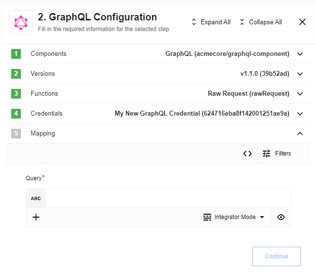
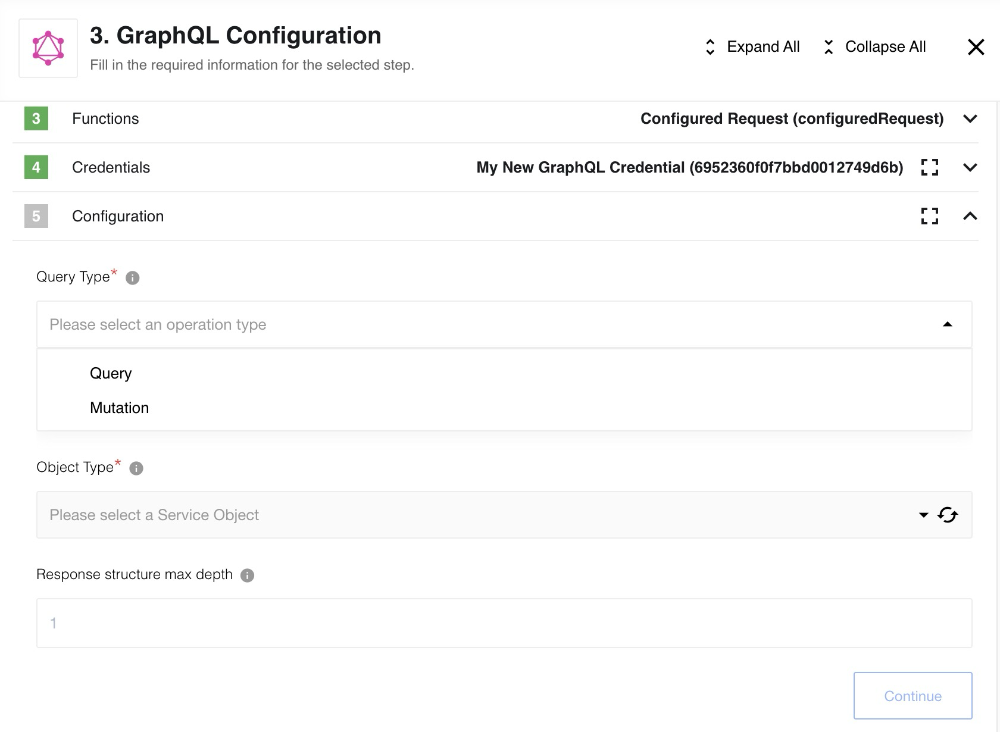

## AVA candidate status — host introspection awaiting review and integration

**Untagged; not installed.** [Draft PR4](https://github.com/thatapp/connector-blendededge-graphql-component-oih/pull/4) pins [corrected source 9e5e8073962c9a7ade70e6cafb17f3e78a2641fc](https://github.com/thatapp/connector-blendededge-graphql-component-oih/tree/9e5e8073962c9a7ade70e6cafb17f3e78a2641fc) and the [full report](https://github.com/thatapp/connector-blendededge-graphql-component-oih/blob/9e5e8073962c9a7ade70e6cafb17f3e78a2641fc/REPORT.md). Both Node 20.20.2/24.13.0 final runs pass 72 unit tests, 18 canonical outcomes, unchanged require allowlist, 71-file secret scans, standalone hostcheck and 31 supplemental actual workers. Independent review clears all three reproduced defects with 125 independent workers per runtime and zero external calls. [Immutable corrected receipts](https://gitlab.com/TECHeGO/thatapp-ai-powered/-/tree/47933c316c1d1bcf8d8c96c76ee6b1a73ee29ecd/docs/ipaas/source-inventory-2026-10-30/graphql-correction-intake) preserve the final runs and review; earlier failed evidence remains historical.

Raw Request accepts one GraphQL query/mutation and emits body.data. Configured Request introspects the chosen root operation field, maps arguments/defaults and expands output fields. No triggers or automatic pagination are added. Credentials support no auth, Basic and a custom API-key header; the historical repeated Basic Auth wording under API Key is erroneous. Transport uses host-recorded Axios and a pinned pure GraphQL.js library. Archived OIH query/mutate actions and triggers do not represent the adapted contract.

The corrections preserve native responses unless the exact status/header preview marker is present, reject all three method-override header aliases, and bound input metadata expansion across all arguments to 1500 nodes and the complete model to 256 KiB before a business POST. Recursive/deeper-than-12 schemas, output expansion beyond 1500 fields or 64 KiB selections, and nested fields needing unmapped arguments refuse. ENUM values cannot be supplied; a provider default may be used by omitting that argument, including a non-null ENUM with a default. Custom scalars remain opaque JSON. The historical depth control is declared but does not truncate execution. Requests are bounded to 1 MiB and responses to 4 MiB/depth 40. GraphQL partial-data errors throw before emission.

Current ordinary GET metadata/select routes cannot resolve saved credentials or send introspection POSTs. [Host #88](https://gitlab.com/TECHeGO/thatapp-ai-powered/-/issues/88) now has [Draft MR164](https://gitlab.com/TECHeGO/thatapp-ai-powered/-/merge_requests/164), pinned at 8ef36036afd4e7c3bc3a9dad117a9558c380ae54. Its new authenticated saved-step POST forms resolve a scoped static credential, require an engine-enabled exact clean build, and make one parent-owned fixed introspection request. A sealed worker receives a no-auth schema replay. Ordinary clean-room POST behavior is unchanged. Short credential values colliding with schema identifiers cause a fixed refusal before replay. These routes are a candidate capability; UI adoption and installed availability are unverified.

Host owner qualification passes 112 focused checks per runtime, including 8 model and 15 adversarial workers, plus regressions of 66/78/109 checks and a 27-file secret scan. Three Podio groups lack samples and two existing workspace API documentation omissions remain. Independent host review and conflict resolution/integration are pending; no live TLS/provider or compressed-response interoperability is claimed. Host #72 and UI/scope qualifications #57/#80 remain. No tag or release count includes this candidate. Historical examples and releases below retain their original facts.

---

* [General information](#general-information)
   * [Description](#description)
   * [Completeness Matrix](/components/graphql/technical-notes#completeness-matrix)
* [Credentials](#credentials)
* [Actions](#actions)
   * [Raw Request](#raw-request)
   * [Configured Request](#configured-request)
* [Known Limitations](#known-limitations)

## General information

### Description
[GraphQL](https://graphql.org/) is a query language for APIs and a runtime for fulfilling those queries with your existing data.

## Credentials

* **Endpoint** - (string, required) set endpoint to your GraphQL API.
* **Type** - (dropdown, optional, default to `No Auth`) may be used when authorization needed
  * **No Auth** - don't use any authentication
  * **Basic Auth** - use HTTP Basic access authentication
    * **Username** - provide a username
    * **Password** - provide a password
  * **API Key Auth** - use HTTP Basic access authentication
    * **Header Key** - custom HTTP Header
    * **Header Value** - HTTP Header value

## Triggers

This component has no trigger functions. This means it will not be accessible to select as a first component during the integration flow design.

## Actions

### Raw Request

Action to execute provided raw GraphQL request string

#### Config Fields

There is no Config Fields in GraphQL component.

#### Input Metadata

* **Query** (string, required) - Your query, represented as text inside **"query"** key.



<details close markdown="block"><summary><strong>Click to expand for more details:</strong></summary>

```
{
  allFilms {
    films {
      title
    }
  }
}
```

</details>

#### Output Metadata

* Depends on Query execution result, represented as object inside **"data"** key.

<details close markdown="block"><summary><strong>Click to expand for more details:</strong></summary>

  ```json
   {
   "allFilms": {
      "films": [
         {
         "title": "A New Hope"
         },
         {
         "title": "The Empire Strikes Back"
         },
         {
         "title": "Return of the Jedi"
         },
         {
         "title": "The Phantom Menace"
         },
         {
         "title": "Attack of the Clones"
         },
         {
         "title": "Revenge of the Sith"
         }
      ]
   }
   }
  ```

</details>

### Configured Request

Action to execute custom GraphQL request for chosen service



#### Config Fields

* **Query Type** (dropdown, required) - Select one of the supported query types:
  * **Query** - use to fetch data
  * **Mutation** - use to modify server-side data
* **Object Type** (dropdown, required) - Select Object you want to fetch/modify
* **Response structure max depth** (number, optional) - Set dependent objects depth, defaults to - 1

#### Input Metadata

Autogenerated based on GraphQL introspection mechanism and includes all available query objects fields

#### Output Metadata

Depends on Query execution result, represent An object inside **"data"** key, includes Pagination and Edges


## Known limitations

1. `Configured Request` action does not support ENUM inputs.
2. Only arguments may be used in `Configured Request` action (selection of `fields` is not available yet and all available fields would be returned in response)
3. Configuration of `Response structure max depth` feauture in `Configured Request` action would not affect on actual result: all available fields would be returned with max available depth.
