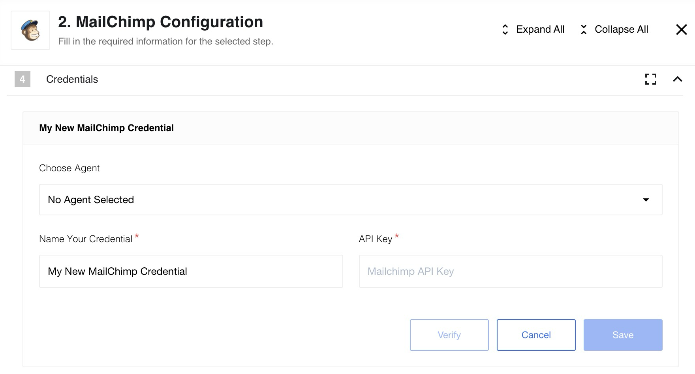
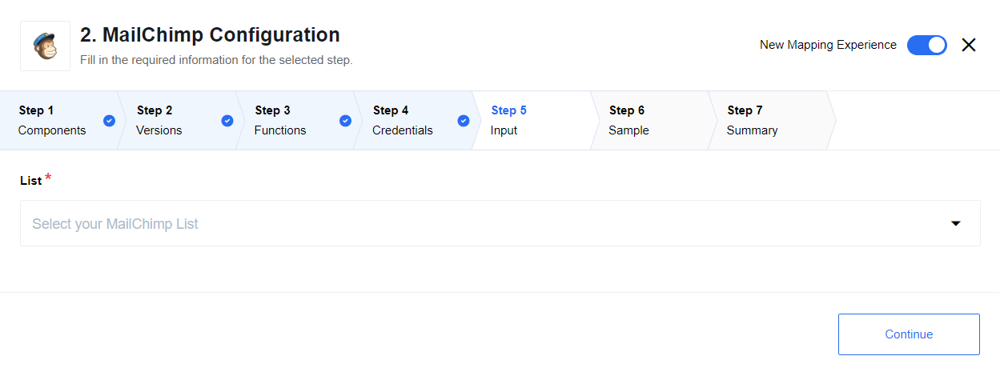
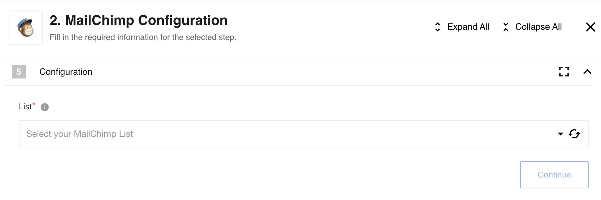
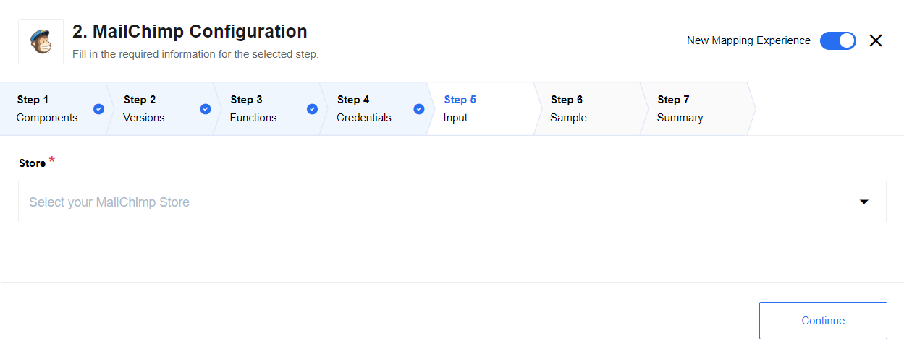

> **AVA `1.0.0` published; installation conditional.** [Connector PR1](https://github.com/thatapp/connector-mailchimp/pull/1) publishes `4b1b77c39d6cf00c12311b8b50f6e48d92cf23ca`. All three documented actions, list/store selectors and dynamic list-specific merge metadata are built. Node 20/24 each pass 45 unit tests, nine canonical and nine standalone rows, allowlist/secret checks and 13 independent isolated workers. [The source-pinned report](https://github.com/thatapp/connector-mailchimp/blob/4b1b77c39d6cf00c12311b8b50f6e48d92cf23ca/REPORT.md) records bounds and retained failures. Host conditions [#57](https://gitlab.com/TECHeGO/thatapp-ai-powered/-/issues/57), [#72](https://gitlab.com/TECHeGO/thatapp-ai-powered/-/issues/72) and [#80](https://gitlab.com/TECHeGO/thatapp-ai-powered/-/issues/80) remain. **No READY/install or final combined-host qualification.** Live Mailchimp permissions and deployment remain UNVERIFIED.

## Table of Contents

* [Description](#description)
* [Credentials](#credentials)
* [Actions](#actions)
  * [Add new Subscriber](#add-new-subscriber)
  * [Unsubscribe](#unsubscribe)
  * [Upsert Customer](#upsert-customer)

## Description

A robust connector designed to interface seamlessly with the Mailchimp API (v3.0). This component allows you to manage subscribers, handle unsubscriptions, and sync eCommerce customer data.

## Credentials

Authentication is handled via a Mailchimp API Key. You can generate this key within your Mailchimp account settings under Extras > API Keys.

## Triggers

This component has no trigger functions. This means it will not be accessible to
select as a first component during the integration flow design.

## Actions

### Add new Subscriber

This action adds a new member to a specified list or updates their information if the subscriber already exists (upsert).

**Dynamic Metadata:**
The mapping section for this action is dynamic. Once you select a Mailchimp List, the component automatically retrieves all specific **Merge Fields** (custom fields) defined for that list, allowing you to map them directly.

**API Endpoint:**
``PUT /lists/{list_id}/members/{subscriber_hash}``

See [here](http://developer.mailchimp.com/documentation/mailchimp/reference/lists/members/#edit-put_lists_list_id_members_subscriber_hash)
for more information

### Unsubscribe

This action uses the documented `DELETE /lists/{list_id}/members/{subscriber_hash}` endpoint to **archive** a member from the selected list. It does not permanently delete a contact or set their status to `unsubscribed`. The previous permanent-deletion description was incorrect; see the [official archive reference](https://mailchimp.com/developer/marketing/api/lists/members/delete-member).

**API Endpoint:**
``DELETE /lists/{list_id}/members/{subscriber_hash}``

See [here](http://developer.mailchimp.com/documentation/mailchimp/reference/lists/members/#delete-delete_lists_list_id_members_subscriber_hash)
for more information.

### Upsert Customer

This action syncs customer data into a Mailchimp eCommerce Store. It creates a new customer record or updates an existing one based on the provided external ID.

**API Endpoint:**
``PUT /ecommerce/stores/{store_id}/customers/{customer_id}``

See [here](http://developer.mailchimp.com/documentation/mailchimp/reference/lists/members/#delete-delete_lists_list_id_members_subscriber_hash)
for more information.

> **AVA port bounds and differences:** API keys remain sealed and determine the fixed `usN.api.mailchimp.com` origin. Upserts preserve full vendor response bodies; archive success emits `{ "success": true }` after 204. New subscribers use `status_if_new: subscribed`; customer opt-in accepts string or boolean true/false without mutating input. Dynamic metadata preserves required flags and numeric/address types, with vendor failures propagated. UTC opt-in timestamps replace implicit local time. Limits: 1 MiB input, 2 MiB JSON response, depth 32 and 100 pages/10,000 choices. No triggers or raw-request action.
