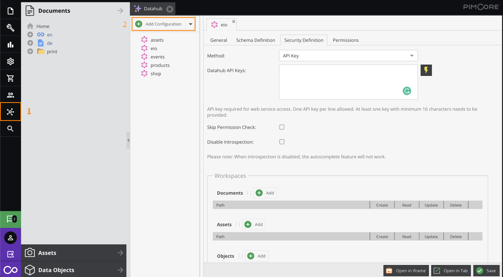

## AVA 1.0.0 release status — 2026-10-30

**PUBLISHED scoped; WAITING HOST #72 secret-recording integration.** [Published source](https://github.com/thatapp/connector-pimcore/tree/72c2388acc93bece3b02eef95519ff38c1c41e09) · [Contract report](https://github.com/thatapp/connector-pimcore/blob/72c2388acc93bece3b02eef95519ff38c1c41e09/REPORT.md) · [Intake evidence](https://github.com/thatapp/connector-pimcore/blob/72c2388acc93bece3b02eef95519ff38c1c41e09/evidence/pimcore-precommit-intake-node24.json).

The documented Raw Request action sends JSON {query} to a configured HTTPS Datahub endpoint with the exact custom API-key header. There are four credential fields, no action configuration and no triggers. HTTP Basic encoding is not invented. This chat read the published report and accepted immutable intake: 28 offline tests, 21 canonical actual-worker outcomes, allowlist and secret scan passing (51 files in the committed receipt). Publisher qualification also reports 28 sealed tests, 30 independent worker outcomes and eight real catalog/split/AES/resolver credential checks per runtime; those supplemental suites were not rerun here.

GraphQL queries and mutations support aliases, fragments, literals, default and nullable variables. Validation allows one executable operation, at most 256 KiB UTF-8 and 10000 parser tokens. Tenant schema and workspace permissions remain server checks. Native data, null/zero/false values and optional extensions are preserved. GraphQL errors fail with 502 and discard partial data without vendor-error echo. Mutations are not retried. Clean-room POST is recorded unsent and refuses fabricated success.

Verification queries __typename and requires a nonempty root type; it does not install Datahub or require complete introspection. External variables, operationName, subscriptions, multipart uploads and schema introspection UI are not exposed. Reserved transport/cookie/proxy headers, URL credentials/fragments and auth query fields refuse. Live key validity, tenant permissions, mutations and old/current Pimcore compatibility remain unverified.

Actual saved-credential tests use initially empty separate parent/HTTP redactors. Long, short, single-character and encoded-short keys remain secret-store values, reach the exact header and are masked in records. Raw emitted business values remain unchanged; single-character masking can also mask matching substrings in unrelated saved descriptions. The earlier short-value leak is retained as historical evidence. No OAuth/provider blocker is inferred for this API-key contract.

Qualification pins host `4576be108e21b597d1fbffd4163fb05cd821c834` and harness `5acb7d929bb1a32ea36699ff0de8f4b034e06ef0`. The tag report incorrectly described published files as exact LF source bytes. An append-only [provenance correction](https://github.com/thatapp/connector-pimcore/blob/5a613c8bdcbdae9f41acaf00f3981e8e34228558/evidence/line-ending-correction.md), independently read here, records source LF and published CRLF for eight files, identical after newline normalization. Published raw hashes and tested checkout bytes match. The immutable tag and runtime remain unchanged. This chat independently verified the tag and preserved main.

Installation, deployment, live vendor/account acceptance and UI behavior remain **UNVERIFIED**. Follow the single [#62 install table](https://gitlab.com/TECHeGO/thatapp-ai-powered/-/issues/62). Historical metadata and reference text below remain for context; the published scope and limitations above supersede conflicting runtime claims.

---

## General information

### Description

Pimcore data can be exposed with [Datahub](https://pimcore.com/docs/data-hub/current/). Under the hood it utilizes GraphQL query language.
For the component to work this bundle must be installed and enabled.

Once the bundle is installed you can go to Datahub - Add Configurations -> GraphQL and setup query, mutation schemas, API keys, permission access, etc. from there.



### API version

The component has been tested with Pimcore v10.5.14.

### Environment variables

No required variables.

## Credentials

* **Endpoint** - (string, required) set endpoint to your Pimcore GraphQL API.
* **Type** - (dropdown, required) may be used when authorization is needed. Currently API Key only is available
  * **API Key Auth** - use HTTP Basic access authentication
    * **Header Key** - custom HTTP Header
    * **Header Value** - HTTP Header value

## Triggers

This component has no trigger functions. This means it will not be accessible to select as a first component during the integration flow design.

## Actions

### Raw Request

Action to execute provided raw GraphQL request string

#### Configuration Fields

There is no configuration fields in this action.

#### Input Metadata

* **Query** (string, required) - Your query, represented as text inside **"query"** key.

<details close markdown="block"><summary><strong>Click to expand for more details</strong></summary>

  ```
  query {
    getCar(id: 308) {
      name
      description
      color
      priceInEUR
    }
  }
  ```
</details>

#### Output Metadata

* Depends on Query execution result, represented as object inside **"data"** key.

<details close markdown="block"><summary><strong>Click to expand for more details</strong></summary>

```json
{
  "data": {
    "getCar": {
      "name": "600",
      "description": "<p>The BMW 600 is a four-seater microcar produced by the German automaker BMW from mid-1957 until November 1959. Partially based on the BMW Isetta two-seater, it was BMW's first postwar four-seater economy car. It was not a sales success, but it began the design process for its more successful successor, the BMW 700.</p>\n",
      "color": [
        "red",
        "white"
        ],
      "priceInEUR": 47195.95
    }
  }
}
```

</details>
