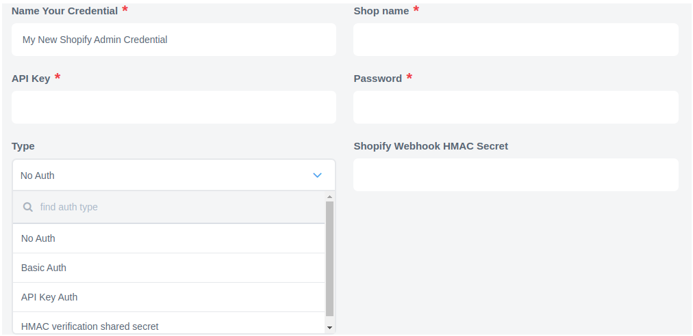

## AVA 1.0.0 candidate — 2026-10-31

**Published conditionally; not installed or deployment-ready.** [Exact source](https://github.com/thatapp/connector-shopify-admin-component-v2/tree/8c546552d2aae048a1b5d120aecc55624f2cca36) · [Complete report and bounds](https://github.com/thatapp/connector-shopify-admin-component-v2/blob/8c546552d2aae048a1b5d120aecc55624f2cca36/REPORT.md) · [Draft review PR](https://github.com/thatapp/connector-shopify-admin-component-v2/pull/1).

Five actions/two triggers on pinned GraphQL2026-10. Customer-only upsert; bounded customers/products/orders polling. Host owns capability and durable webhook delivery; body HMAC does not authenticate unsigned routing/delivery headers. Public signature skipping is refused. Legacy REST documentation is a separate contract.

104 tests/23 canonical/23 standalone/161-file secrets each Node20/24; original-byte signed webhook and lifecycle workers. All four intake gates pass with synthetic data and zero external attempts. Receipts use host b48061d6ac446698d772a3aec2b156e018e4a760 and harness6746b51f6f9673493b2ead12ed1b1f1efeb599bf. These are separate-host checks; final combined-host qualification is pending. Conditions #57/#72/#74/#80 remain. Installation status is governed by the single [#62 table](https://gitlab.com/TECHeGO/thatapp-ai-powered/-/issues/62); historical release notes below do not establish current runtime support.

---


## How works. API version

Component was tested on `2021-04` API version.
You can find more information about API versioning at Shopify [here](https://help.shopify.com/en/api/versioning).

[Shopify API documentation](https://help.shopify.com/api/reference).

## Requirements

### Credentials

To create the credentials you should do the following:
- In your shop go to Apps - App and sales channel settings
- Click the 'Develop Apps' button
- Click the 'Create an app' button and give your app a name
- Enable the scopes you need and click Save
- On the 'API credentials' tab copy your `API key` and `API Secret Key`
- Install the app
- Once the app is installed a new credential `Admin API access token` appears. Copy this one as it can only be revealed once



- *ShopName* - Name of your shop, for example, `quickstart-974c9379.myshopify.com`
- *API Key*- A string that specifies the API key of the app. Use `API key` from the Shopify app credentials creation step
- *Password* - A string that specifies the private app password. Use `Admin API access token` from the Shopify app credentials creation step
- *Type* - select 'No Auth' type. It will use the API credentials you specified
- *Shopify Webhook HMAC Secret* - this field is used and required **only** for trigger `Webhook subscription` to [sign the request with an HMAC header](https://shopify.dev/apps/webhooks/configuration/https#step-5-verify-the-webhook).
  Use `API Secret Key` from the Shopify app credentials creation step

You can find additional information on how to generate the creds in Shopify [documentation](https://shopify.dev/tutorials/authenticate-a-private-app-with-shopify-admin#generate-credentials-from-the-shopify-admin)

### Environment variables

| Name | Mandatory | Description | Values |
|---------------------|-------|------------------------------------------|--------------------|
|SHOPIFY_API_VERSION| false | Determines API version of Shopify to use | Default: `2019-10`, for Make Raw Request: `2021-04` |

### Metafield Notes

Metafields for an object can be written when upserting/creating an object that
supports metafields. When polling for objects, looking up an object or searching
for objects, there is a checkbox that can be selected that will fetch the
corresponding metafields for objects. Selecting this checkbox will cause more
API calls to be consumed. (An additional API call per object read.)

When reading metafields data will be returned in this format. When writing
metafield data, the following format is also expected for the `metafields` object.

```json
{
  "metafieldNamespaceOne": {
    "metafieldKeyOne": "Metafield Value for metafieldNamespaceOne.metafieldKeyOne",
    "metafieldKeyTwo": "Metafield Value for metafieldNamespaceOne.metafieldKeyTwo"
  },
  "metafieldNamespaceTwo": {
    "metafieldKeyThree": "Metafield Value for metafieldNamespaceTwo.metafieldKeyThree"
  }
}
```

Shopify metafields support the following three types:

* `integer`  metafields will be created whenever the value provided for a metafield is a JSON number that is an integer. When reading Shopify `integer` metafields, they will result in JSON numbers.
* `string` metafields will be created whenever the value provided for a metafield is a JSON string or a JSON number that is not an integer. When reading any Shopify `string` metafields, they will result in JSON strings regardless of whether or not they could be parsed as numbers.
* `json_string` metafields will be created whenever the value provided for a metafield is a JSON object, array or boolean. The incoming value will be converted to a JSON string and stored. When reading Shopify metafields, they will be converted back to their JSON forms.

Setting a metafield the value of JSON `null` will result in that metafield being deleted.

Not setting a value for a metafield will result in that metafield being unchanged.

### Technical Notes

The [technical notes](technical-notes) page gives some technical details about
Shopify component like [changelog](technical-notes#changelog) and
[completeness matrix](technical-notes#completeness-matrix).

## Triggers

Shopify component has the following triggers:

1.  [Polling Trigger](triggers#polling-trigger) - Polls Shopify API for new and updated objects.
2.  [Webhook subscription trigger](triggers#webhook-subscription) - Creates webhook subscriptions on the Shopify side and receives events to the flow.

## Actions

Shopify component has the following actions:

1.  [Lookup Object action](actions#lookup-object) - Finds object by id.
2.  [Lookup Objects action](actions#lookup-objects) - Retrieves object by ID.
3.  [Create Object action](actions#create-object) - Action to create new object instance. Only for object that can’t be updated.
4.  [Upsert Object action](actions#upsert-object) - Upsert Object action is useful if it isn’t known if there is already an object in the system. Action determines if the data needs to be matched to an existing object or added to a new one. Only for objects that can be created and updated.
5.  [Delete Object action](actions#delete-object) - Delete Object By Unique Criteria
6.  [Make Raw Request](actions#make-raw-request) - Allows you to manually construct individual requests to be sent to the API.

>We keep the list of deprecated actions on a separate page. Please read this [article](deprecated-actions#table-of-contents) for more details.

## Links

[Shopify API documentation](https://help.shopify.com/api/reference)

[How to generate creds](https://shopify.dev/tutorials/authenticate-a-private-app-with-shopify-admin#generate-credentials-from-the-shopify-admin)
