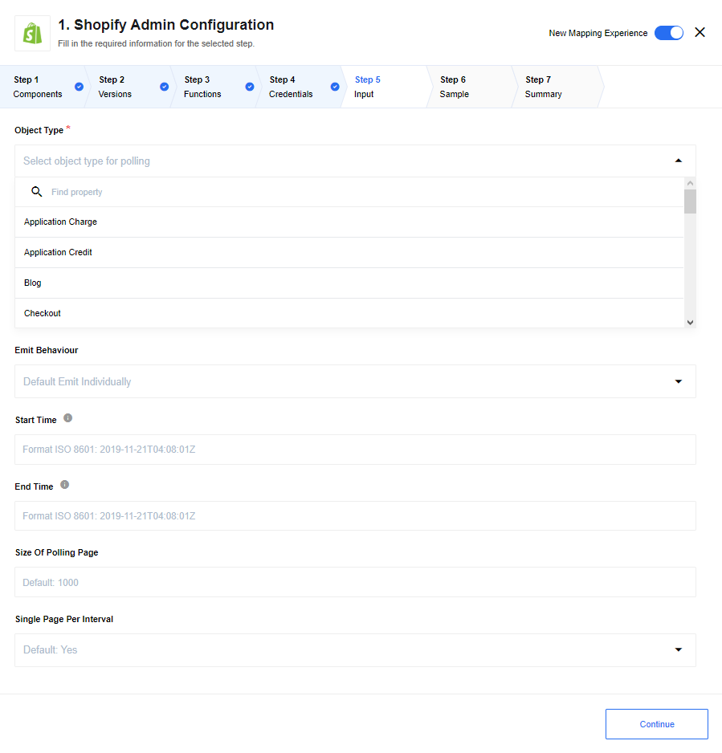

## AVA 1.0.0 candidate — 2026-10-31

**Published conditionally; not installed or deployment-ready.** [Exact source](https://github.com/thatapp/connector-shopify-admin-component-v2/tree/8c546552d2aae048a1b5d120aecc55624f2cca36) · [Complete report and bounds](https://github.com/thatapp/connector-shopify-admin-component-v2/blob/8c546552d2aae048a1b5d120aecc55624f2cca36/REPORT.md) · [Draft review PR](https://github.com/thatapp/connector-shopify-admin-component-v2/pull/1).

Five actions/two triggers on pinned GraphQL2026-10. Customer-only upsert; bounded customers/products/orders polling. Host owns capability and durable webhook delivery; body HMAC does not authenticate unsigned routing/delivery headers. Public signature skipping is refused. Legacy REST documentation is a separate contract.

104 tests/23 canonical/23 standalone/161-file secrets each Node20/24; original-byte signed webhook and lifecycle workers. All four intake gates pass with synthetic data and zero external attempts. Receipts use host b48061d6ac446698d772a3aec2b156e018e4a760 and harness6746b51f6f9673493b2ead12ed1b1f1efeb599bf. These are separate-host checks; final combined-host qualification is pending. Conditions #57/#72/#74/#80 remain. Installation status is governed by the single [#62 table](https://gitlab.com/TECHeGO/thatapp-ai-powered/-/issues/62); historical release notes below do not establish current runtime support.

---

## Polling Trigger

Polls Shopify API for new and updated objects.

### List of Expected Configuration fields

*   **Object Type** - Object type for polling.
*   **Emit Behaviour** - Options are: default is `Emit Individually` emits each object in separate message, `Fetch All` emits all objects in one message and `Fetch Page` emits object in messages size of `Size Of Polling Page`.
*   **Start Time** - Start datetime of polling. Default min date:`1970-01-01T00:00:00.000Z`
*   **End Time** - End datetime of polling. Default max date: `Current Timestamp`
*   **Size Of Polling Page** - Size of polling page, used in Fetch Page behaviour to determine size of emitted message. Default: `50`
*   **Single Page Per Interval** - If `Yes` polls for one page each execution, if `No` polls for all pages in one execution, exception - `Emit Behaviour` - `Fetch All` that always poll all records. Default: `Yes`
*   **Fetch Metafields for Object** - If selected, in addition to returning the built-in fields associated with the object, return the metafields.

## Webhook subscription

Creates webhook subscriptions on the Shopify side and receives events to the flow.

### List of Expected Configuration fields

*   **Object Type** - Object type for polling.

### Links to documentation

You can find more information in the [Webhook Documentation](https://help.shopify.com/en/api/reference/events/webhook).
