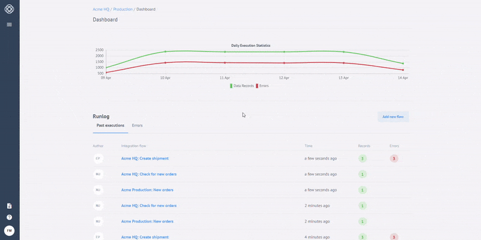
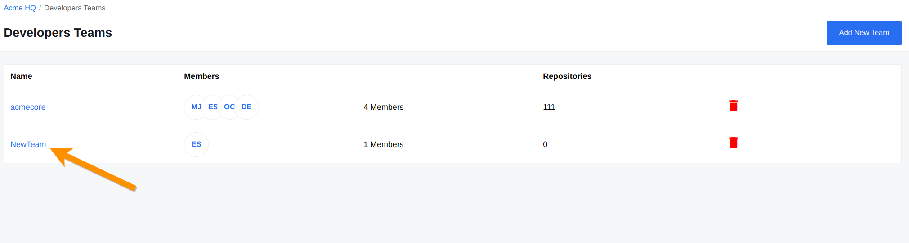
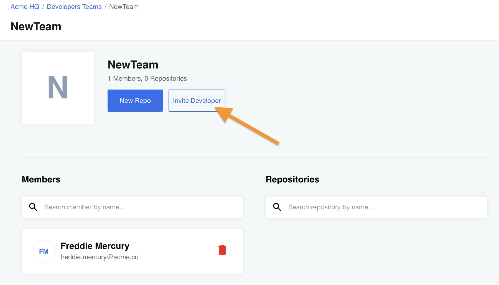
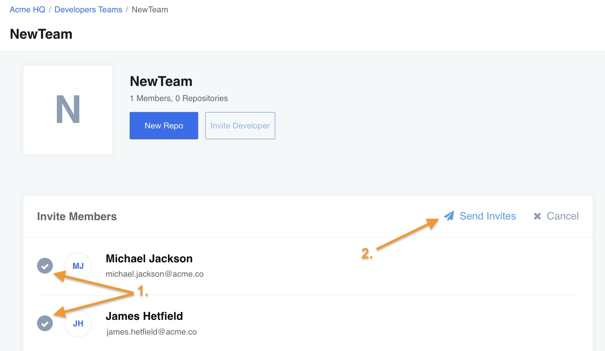

Developer teams organize component repository records. In the beta, a repository record stores its configuration. Creating or editing a record does not push to GitHub or deploy a component.

## Manage developer teams

A developer team controls access to the component repositories belonging to that
team. The team members may collaborate on common integration component in integration projects.

### Creating a developer team

>**Note**: you must have appropriate [permissions](/guides/managing-user-roles-in-a-tenant).

To create a new developer team, navigate to *Developer Teams* and click *Add New Team* button. Then give the team a unique name and click *Save*. Your team has been added to the list:

>**Note**: you can only use letters, digits, `-` and `_` to name your team.

To access your new team, click on the team name:

As you can see, you're the only member of the team. To add more developers, click *Invite Developer*:

You will see a list of members **(1)**, which you can choose from. Select the required members and click *Send Invites* **(2)** to invite developers:

As soon as you click *Send Invites*, the selected users become team members.

>**Please Note:** that only members of the same Contract can be invited into this developer team. The list shows all the possible members that can be invited to this current team.

### Delete the developers team

If you need to delete a developer team:
*   You should have the appropriate [permissions](/guides/managing-user-roles-in-a-tenant) and
*   The developer team must contain no integration component.

If the above conditions are true, you can proceed and delete the developer team using an API call or via UI. However, the functionality of the endpoints is not limited to these two actions. You can find out more about this in the [API documentation]({{site.data.tenant.apiDocsUri}}/v2#/teams).

## Manage integration components

### Create a component repository

Use Developer Teams to create a repository record for your team. GitHub synchronization and deployment from that record are outside the beta.

### Manage the component repository

Use the repository details page to review the record and its access settings.

## Managing Environment variables

Values entered for a repository are stored sealed. The beta does not deliver those values to running steps.

## Related links

- [Integration Component Overview](/getting-started/integration-component)
- [Managing user roles in a tenant](/guides/managing-user-roles-in-a-tenant)
- [Delete the developer team]({{site.data.tenant.apiDocsUri}}/v2#/teams/delete_teams__team_id_)
