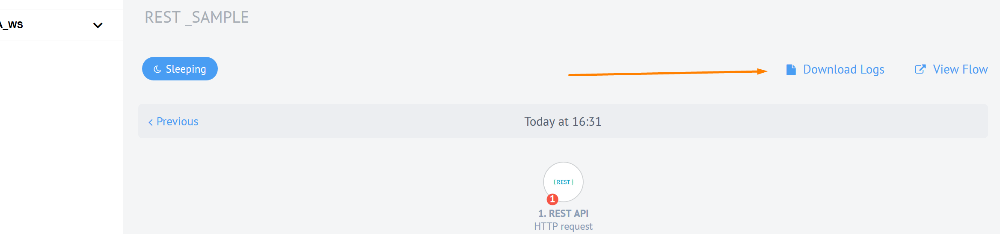
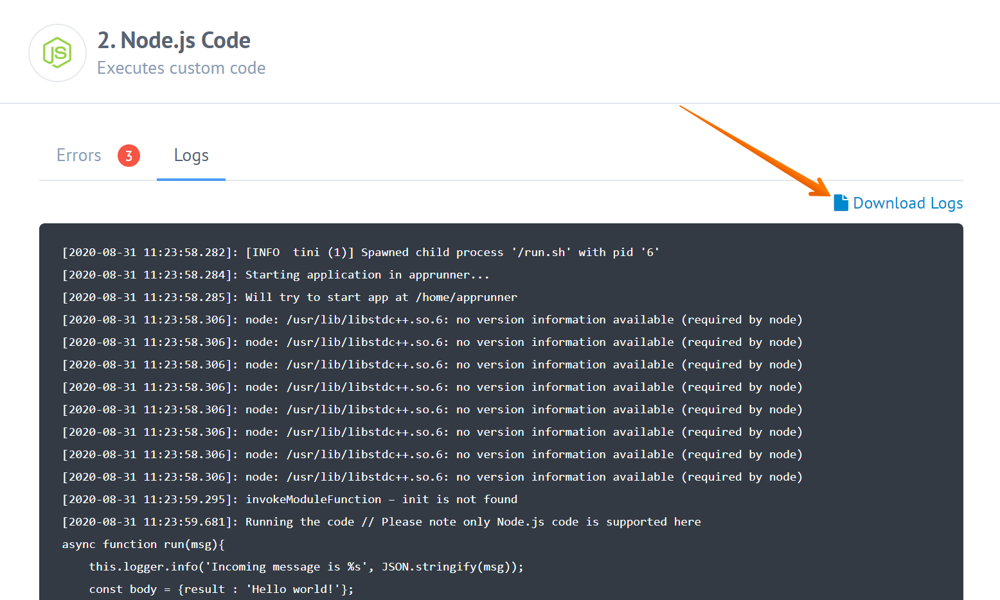

This document describes the way to find errors that occur in your Flows, and deal with them.

## Flow Errors

Let's start with the fact, that no errors on the Platform are fatal. There is never a reason to panic - everything has a solution. Maybe you won't even need any assistance with it. To see your failed runs, open the [Executions](executions) page and filter it by *Status: Erroneous*.

Click a row to open that run. An alert above the steps says which step failed, what the server reported and when it happened, and the step is marked *Failed*.

To read the logs, use *Download Logs* on the run page to save that run's logs, or open the [Logs](/getting-started/logs-page) page and filter by flow name, level, date range or search text.

By analyzing the logs, you can, most likely, find the cause of the error, and come up with a solution. You can also ask our Support for assistance.

## Downloading the Logs

Logs of a particular component or integration flow may contain some important
information that is useful when investigating issues. With the Download Logs
feature, an integration administrator or integration developer can download
complete logs of a single connector or even a whole flow. This allows to analyze
them without having to page through them via {{site.data.tenant.name}} UI.

You can also download logs by clicking the corresponding button for:

### Integration Flow Logs

You can download logs of the one execution for whole integration flow as shown
below:

The downloaded logs are in `.log` format and contain logs of all steps in one
execution sorted according to the time-stamp.

### Integration Step Logs

You can download logs of the one step during the same execution the following way:

This will get you a copy of the required logs in `.log` format.
