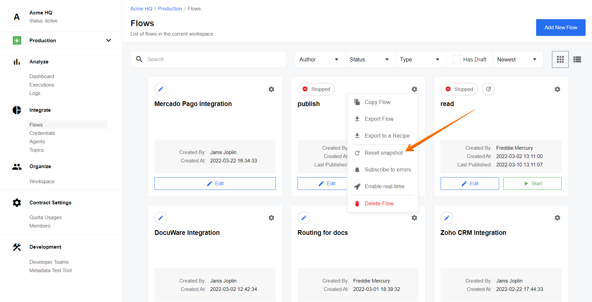

{{page.description}}

## Creating and Using a Snapshot

To create a [Snapshot](/developers/snapshot-overview.html), you need to emit it
from your Component function:

`emit('snapshot',snapshot)`

Let's see how it works with querying objects by timestamp:

1.  Query all objects since 2017, 1 Jan to establish the first point of reference. Typically, this happens on the first global sync between two systems.
2.  Iterate over all objects. In some cases this stage can take a while due to the amount of data in the source system, therefore it is recommended to use paging if the originating API supports it.
3.  Calculate the last update date based on returned objects. It's not recommended to calculate the last date as current time as you can miss some objects. This stage is also dependent on the originating API properties.
4.  Emit the new last date as snapshot after iterating through all objects.

In this example, `readPages(since)` reads the source API's pages of records updated after `since`. Each record has an `updatedAt` timestamp. The step stores the latest timestamp in its snapshot after it processes every page. An empty result keeps the previous timestamp.

```javascript
async function pollUpdates(snapshot, readPages, emit) {
  let since = snapshot && snapshot.lastSeen;
  if (typeof since !== 'string' || !Number.isFinite(Date.parse(since))) {
    console.warn('Using the initial polling timestamp');
    since = '2017-01-01T00:00:00.000Z';
  }

  let latest = Date.parse(since);
  for await (const page of readPages(since)) {
    for (const record of page) {
      const updated = Date.parse(record.updatedAt);
      if (!Number.isFinite(updated)) throw new Error('Record has an invalid updatedAt');
      await emit('data', { body: record });
      latest = Math.max(latest, updated);
    }
  }
  await emit('snapshot', { lastSeen: new Date(latest).toISOString() });
}
```

>**IMPORTANT:** Please remember that there can be only one snapshot per step in a Flow. Each time another snapshot is made, the last one is overwritten.

### Count runs with a Code trigger

Paste this example into a polling [Code component](/components/code/). The platform supplies the `messages` helper and the step's previous snapshot. On the first run the trigger emits `{ "iteration": 1 }`. On the next run it reads the saved count and emits `{ "iteration": 2 }`.

```javascript
async function run(msg, cfg, snapshot) {
  const iteration = (snapshot?.iteration ?? 0) + 1;
  await this.emit('data', messages.newMessageWithBody({ iteration }));
  await this.emit('snapshot', { ...snapshot, iteration });
}
```

Additionally, there is a way to reset snapshot for a Flow via the UI. Here is how it is done:



## Snapshots via the API

There is a number of API endpoints for creating and using snapshots. They allow
you to (follow the links for details):

1.  [Retrieve snapshots for all steps in Flow.]({{site.data.tenant.apiDocsUri}}/v2#/snapshots/get_flows__flow_id__snapshots)
2.  [Retrieve snapshot for one step in Flow.]({{site.data.tenant.apiDocsUri}}/v2#/snapshots/get_flows__flow_id__snapshots__step_id_)
3.  [Edit snapshot for one step in Flow.]({{site.data.tenant.apiDocsUri}}/v2#/snapshots/patch_flows__flow_id__snapshots__step_id_)
4.  [Create snapshot for one step in Flow.]({{site.data.tenant.apiDocsUri}}/v2#/snapshots/post_flows__flow_id__snapshots)
5.  [Remove snapshot for one step in Flow.]({{site.data.tenant.apiDocsUri}}/v2#/snapshots/delete_flows__flow_id__snapshots__step_id_)
